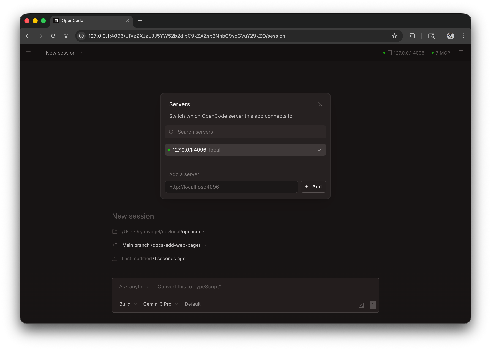

NanoCode puo funzionare come applicazione web nel browser, offrendo la stessa potente esperienza di coding AI senza bisogno di un terminale.


## Per iniziare

Avvia l'interfaccia web eseguendo:

```bash
nanocode web
```

Questo avvia un server locale su `127.0.0.1` con una porta disponibile scelta a caso e apre automaticamente NanoCode nel browser predefinito.

:::caution
Se `NANOCODE_SERVER_PASSWORD` non e impostata, il server non sara protetto. Va bene per l'uso locale, ma va impostata per l'accesso in rete.
:::

:::tip[Utenti Windows]
Per la migliore esperienza, esegui `nanocode web` da [WSL](/docs/windows-wsl) invece che da PowerShell. Questo garantisce accesso corretto al file system e integrazione col terminale.
:::

---

## Configurazione

Puoi configurare il server web con i flag della riga di comando o nel tuo [file di config](/docs/config).

### Porta

Per impostazione predefinita, NanoCode sceglie una porta disponibile. Puoi specificare una porta:

```bash
nanocode web --port 4096
```

### Nome host

Per impostazione predefinita, il server si lega a `127.0.0.1` (solo localhost). Per rendere NanoCode accessibile sulla rete:

```bash
nanocode web --hostname 0.0.0.0
```

Usando `0.0.0.0`, NanoCode mostrera sia l'indirizzo locale sia quello di rete:

```
  Local access:       http://localhost:4096
  Network access:     http://192.168.1.100:4096
```

### Scoperta mDNS

Abilita mDNS per rendere il server individuabile sulla rete locale:

```bash
nanocode web --mdns
```

Questo imposta automaticamente l'hostname a `0.0.0.0` e pubblicizza il server come `nanocode.local`.

Puoi personalizzare il nome di dominio mDNS per eseguire piu istanze sulla stessa rete:

```bash
nanocode web --mdns --mdns-domain myproject.local
```

### CORS

Per consentire domini aggiuntivi per CORS (utile per frontend personalizzati):

```bash
nanocode web --cors https://example.com
```

### Autenticazione

Per proteggere l'accesso, imposta una password usando la variabile d'ambiente `NANOCODE_SERVER_PASSWORD`:

```bash
NANOCODE_SERVER_PASSWORD=secret nanocode web
```

Lo username predefinito e `nanocode`, ma puo essere cambiato con `NANOCODE_SERVER_USERNAME`.

---

## Usa l'interfaccia web

Una volta avviata, l'interfaccia web ti da accesso alle tue sessioni NanoCode.

### Sessioni

Visualizza e gestisci le sessioni dalla homepage. Puoi vedere le sessioni attive e avviarne di nuove.


### Stato del server

Fai clic su "See Servers" per vedere i server connessi e il loro stato.



---

## Collegare un terminale

Puoi collegare una TUI da terminale a un server web gia in esecuzione:

```bash
# Avvia il web server
nanocode web --port 4096

# In un altro terminale, collega la TUI
nanocode attach http://localhost:4096
```

Questo ti permette di usare contemporaneamente interfaccia web e terminale, condividendo le stesse sessioni e lo stesso stato.

---

## File di configurazione

Puoi anche configurare le impostazioni del server nel file di config `nanocode.json`:

```json
{
  "server": {
    "port": 4096,
    "hostname": "0.0.0.0",
    "mdns": true,
    "cors": ["https://example.com"]
  }
}
```

I flag della riga di comando hanno precedenza sulle impostazioni del file di config.
